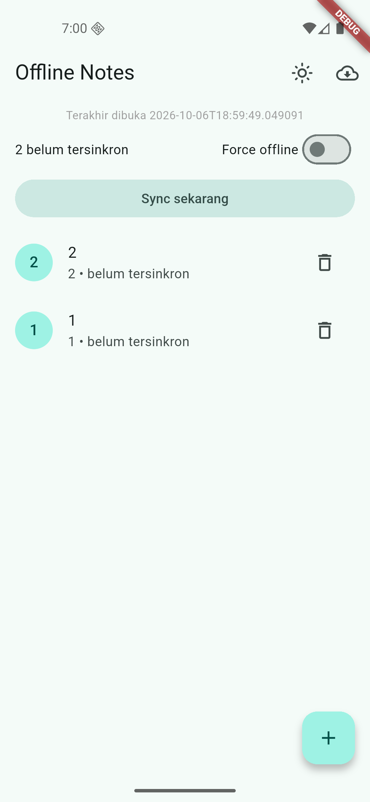
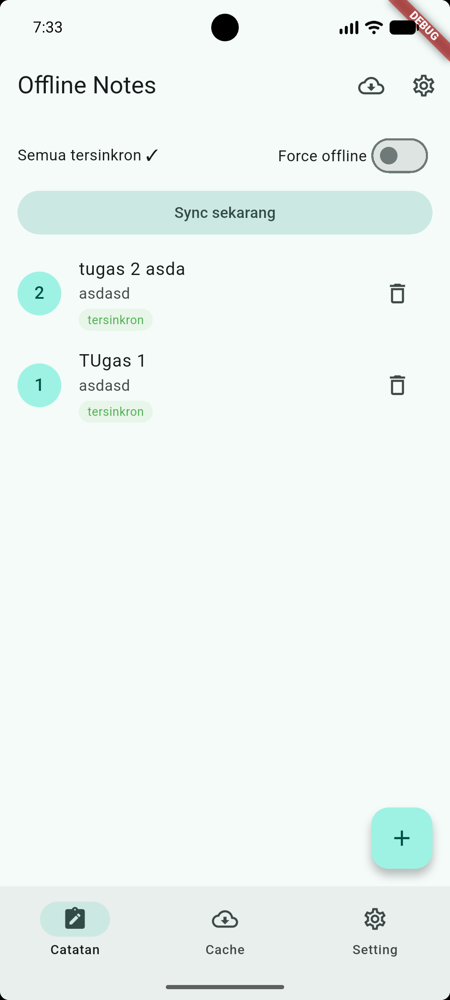

# notes-refactor
File: notes-refactor

# Tugas utama
File: main

---

# AI Prompt Challenge
## Prompt arsitektur
### Perbandingan Struktur Project
| Aspek | Layer-first | Feature-first |
|-------|-------------|---------------|
| Skala | Project kecil satu fitur | Project multi-fitur (pilihan codelab) |
| Hapus fitur | Menyebar ke banyak folder | Satu folder fitur dihapus bersih |
| Ketergantungan | Mudah tercampur | Satu fitur dipahami tanpa menyentuh yang lain |
---
### Trade-off Use Case
| Aspek | Repository langsung | Use case per operasi |
|-------|---------------------|----------------------|
| Kode | Ringkas, cukup untuk CRUD sebaris | Tambahan kelas per operasi |
| Aturan bisnis | Tersebar di notifier | Terpusat dan teruji murni |
| Cocok untuk | CRUD sederhana | Operasi gabungan multi-repository |
---
### Trade-off Either vs Record
| Aspek | fpdart/dartz | Record Dart |
|-------|--------------|-------------|
| Dependensi | Tambah package | Tanpa dependensi tambahan |
| Kontrak gagal | Eksplisit via tipe | Eksplisit via field failure |
---
## Prompt penguatan konsep
Pilih feature-first jika project memiliki banyak fitur yang berkembang dan mengutamakan hapus-pindah fitur tanpa efek samping.
Pilih layer-first jika project kecil satu fitur dan mengutamakan kecepatan awal, dengan risiko berantakan saat fitur bertambah.

## Verification prompt

Tampilan identik sebelum dan sesudah refactor. Yang berubah adalah struktur folder dan arah dependensi.

# Refleksi
1. Mengapa interface repository harus tinggal di domain, bukan di data? Apa yang rusak bila dibalik?
   Interface adalah kontrak kebutuhan domain sehingga domain tidak bergantung pada detail data. Apabila dibalik, domain mengimpor implementasi SQLite/Dio sehingga logika bisnis tidak dapat diuji murni dan arah dependensi melanggar dependency rule.
2. Kapan use case benar-benar dibutuhkan, dan kapan repository langsung ke notifier sudah cukup?
   Use case dibutuhkan apabila operasi menggabungkan lebih dari satu repository atau memiliki aturan bisnis seperti validasi dan sorting. Untuk CRUD sebaris, repository langsung ke notifier sudah cukup dan use case per operasi hanya menjadi over-engineering.
3. Apa biaya over-engineering (use case per CRUD satu-baris) bagi tim kecil? Kapan biayanya sepadan?
   Biayanya adalah kelas dan wiring tambahan yang harus dirawat tanpa manfaat bisnis. Biaya sepadan apabila logika tumbuh kompleks sehingga aturan terpusat lebih murah daripada bug yang tersebar.
4. Bagian mana dari usulan AI yang ditolak atau disederhanakan, dan mengapa?
   Ditolak: use case untuk tiap CRUD sebaris karena over-engineering bagi tim kecil; Either via fpdart/dartz karena record Dart sudah cukup eksplisit; serta package DI tambahan karena Riverpod provider sudah memusatkan wiring.

